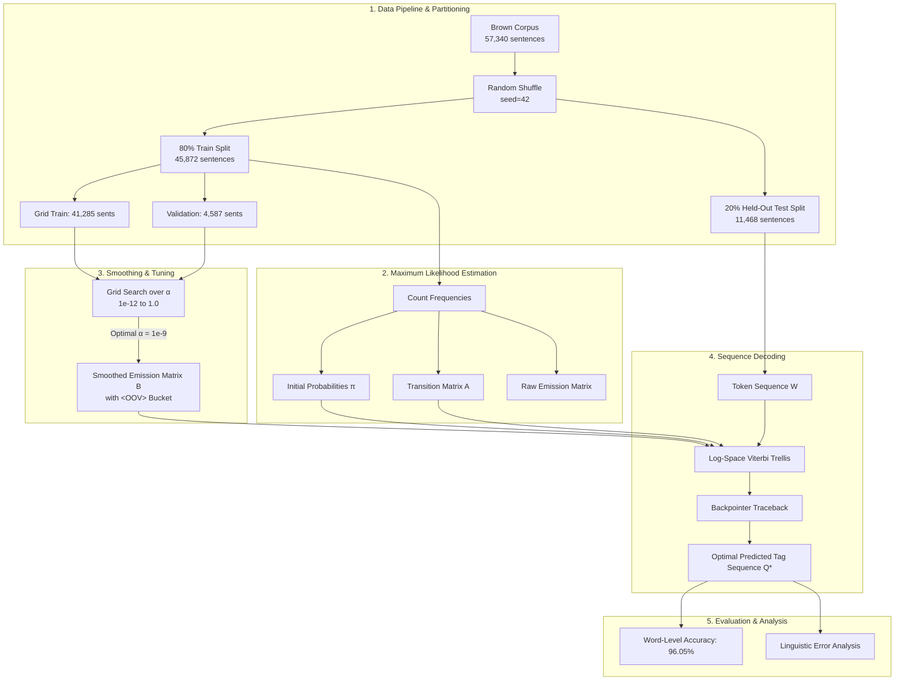

# A Hidden Markov Model Part-of-Speech Tagger with Laplace Smoothing and Log-Space Viterbi Decoding

[](https://www.python.org/)
[](https://www.nltk.org/)
[](https://en.wikipedia.org/wiki/Brown_Corpus)
[]()
[](https://heangdeniss.github.io/HMM-Text_Segmentation/)
[](https://itc.edu.kh/)

> **A from-first-principles implementation of a first-order Hidden Markov Model (HMM) for Part-of-Speech (POS) tagging on the Brown Corpus, resolving Out-Of-Vocabulary (OOV) emission sparsity via tuned Laplace ($\alpha$) smoothing and eliminating numerical underflow through Log-Space Viterbi decoding.**
>
> 🔗 **Live demo:** <https://heangdeniss.github.io/HMM-Text_Segmentation/> — the trained model runs entirely in your browser.

---

## 📌 Table of Contents

- [Overview](#-overview)
- [Key Features](#-key-features)
- [System Architecture](#-system-architecture)
- [Mathematical Formulation](#-mathematical-formulation)
  - [1. Parameter Estimation (MLE)](#1-parameter-estimation-mle)
  - [2. Add-$\alpha$ Laplace Smoothing & OOV Handling](#2-add-alpha-laplace-smoothing--oov-handling)
  - [3. Log-Space Viterbi Decoding](#3-log-space-viterbi-decoding)
- [Dataset & Universal Tagset](#-dataset--universal-tagset)
- [Experimental Results](#-experimental-results)
  - [Hyperparameter Tuning ($\alpha$ Grid Search)](#hyperparameter-tuning-alpha-grid-search)
  - [Test Set Evaluation](#test-set-evaluation)
- [Error Analysis & Linguistic Insights](#-error-analysis--linguistic-insights)
- [Repository Structure](#-repository-structure)
- [Getting Started](#-getting-started)
  - [Prerequisites](#prerequisites)
  - [Installation](#installation)
  - [Running the Notebook](#running-the-notebook)
  - [Command-Line Usage](#command-line-usage)
- [Saved Model & Reuse](#-saved-model--reuse)
- [Live Website & GitHub Pages](#-live-website--github-pages)
- [Authors & Acknowledgments](#-authors--acknowledgments)
- [References](#-references)

---

## 📖 Overview

Part-of-speech (POS) tagging is a foundational sequence labeling task in Natural Language Processing (NLP). Syntactic ambiguity presents a major challenge—a single surface form such as *"watch"* or *"offer"* can act as a **noun** or a **verb** depending on surrounding context.

While standard textbooks describe Hidden Markov Models (HMMs) conceptually, deploying an HMM on real-world text exposes two severe engineering bottlenecks:
1. **Out-of-Vocabulary (OOV) Sparsity**: Test corpora inevitably contain words absent from training. Maximum-likelihood estimation assigns them zero emission probability across all states, rendering entire sentences undecodable.
2. **Floating-Point Underflow**: The standard Viterbi algorithm computes long chains of multiplicative joint probabilities ($P \ll 1.0$), rapidly underflowing to zero in 64-bit IEEE floating-point arithmetic.

This project implements an end-to-end POS tagger from scratch in Python (using standard data structures without opaque sequence-labeling libraries), trained on the **Brown Corpus** with the **12 Universal POS tags**. By coupling **data-driven hyperparameter grid search for Laplace smoothing** with **log-space dynamic programming**, the tagger achieves **96.05% word-level accuracy** on a held-out test set of 232,177 tokens.

---

## ✨ Key Features

- **Pure First-Principles Implementation**: Built using standard Python containers (`defaultdict`, `Counter`) without relying on black-box HMM toolkits (`nltk.tag.hmm` or `hmmlearn`).
- **Log-Space Dynamic Programming**: The Viterbi trellis recursion is reformulated into log-probabilities with $\epsilon = 10^{-12}$ guard offsets, completely preventing floating-point collapse.
- **Dedicated OOV Emission Mass**: Add-$\alpha$ smoothing reserves an explicit, tag-dependent unseen word probability mass ($P(\text{OOV} \mid s_i)$), ensuring any arbitrary input remains decodable.
- **Unbiased Hyperparameter Optimization**: $\alpha$ is swept over 8 orders of magnitude ($10^{-12}$ to $1.0$) exclusively on an internal validation set (10% of training data), avoiding evaluation data leakage.
- **Reproducible Partitioning**: Uses fixed random seeds (`seed=42`) across a randomized 80/20 train/test split of 57,340 sentences across 15 distinct literary and journalistic genres.
- **Persisted Model & Zero-Backend Demo**: A 0.63 MB sparse artifact powers both a Python CLI (`hmm_model.py`) and a static in-browser Viterbi tagger hosted on GitHub Pages.
- **Complete Research Suite**: Accompanied by full academic research papers (`HMM_NLP.pdf`, `HMM_NLP.docx`) and presentation slides (`Slide.pdf`).

---

## 🏗 System Architecture



---

## 📐 Mathematical Formulation

An HMM models the sequence of observed words $O = (o_1, o_2, \dots, o_T)$ generated by a hidden sequence of grammatical tags $Q = (q_1, q_2, \dots, q_T)$ over a state space $S = \{s_1, \dots, s_N\}$ ($N = 12$) and vocabulary $V$ ($|V| = 45,153$).

Under the **first-order Markov assumption** and **output independence assumption**, the optimal tag sequence is:

$$Q^* = \arg\max_{Q} \left[ \pi(q_1) \prod_{t=2}^T P(q_t \mid q_{t-1}) \prod_{t=1}^T P(o_t \mid q_t) \right]$$

### 1. Parameter Estimation (MLE)

- **Initial Distribution ($\pi$)**:
  $$\pi(s_i) = \frac{\text{Count}(\text{sentence begins with } s_i)}{M}$$
  where $M = 45,872$ is the total number of training sentences.

- **Transition Probabilities ($A$)**:
  $$A_{ij} = P(s_j \mid s_i) = \frac{\text{Count}(s_i \to s_j)}{\sum_{k=1}^N \text{Count}(s_i \to s_k)}$$

### 2. Add-$\alpha$ Laplace Smoothing & OOV Handling

The raw emission frequency fails on unseen words. We smooth the emission distribution by adding pseudo-count $\alpha$ and explicitly reserving a token slot for out-of-vocabulary words (`<OOV>`):

- **Known Words ($w \in V$)**:
  $$B_i(w) = P_{\text{smooth}}(w \mid s_i) = \frac{\text{Count}(s_i, w) + \alpha}{\text{Count}(s_i) + \alpha (|V| + 1)}$$

- **Unseen Words ($w \notin V \implies \text{OOV}$)**:
  $$B_i(\text{OOV}) = P_{\text{smooth}}(\text{OOV} \mid s_i) = \frac{\alpha}{\text{Count}(s_i) + \alpha (|V| + 1)}$$

Because $\sum_{w \in V} B_i(w) + B_i(\text{OOV}) = 1.0$, the distribution remains strictly normalized.

### 3. Log-Space Viterbi Decoding

To avoid underflow, we transform products into log-sums. For time step $t$ and state $j$:

$$\log v_t(j) = \max_{1 \le i \le N} \left[ \log v_{t-1}(i) + \log(A_{ij} + \epsilon) \right] + \log(B_j(o_t) + \epsilon)$$

$$\text{backpointer}[t][j] = \arg\max_{1 \le i \le N} \left[ \log v_{t-1}(i) + \log(A_{ij} + \epsilon) \right]$$

where $\epsilon = 10^{-12}$ provides numeric boundary stability.

---

## 📊 Dataset & Universal Tagset

The model is evaluated on the **Brown Corpus** (Francis & Kučera, 1979) mapped onto the **Universal Tagset** (Petrov et al., 2012):

### Corpus Breakdown

| Partition | Sentences | Words / Tokens | Purpose |
| :--- | :---: | :---: | :--- |
| **Full Corpus** | 57,340 | 1,161,192 | Complete 15-genre collection |
| **Training Partition (80%)** | 45,872 | 929,015 | Vocabulary & Parameter estimation |
| ├── *Grid-Search Sub-Train (90%)* | 41,285 | 836,113 | Parameter fitting during grid search |
| └── *Validation Set (10%)* | 4,587 | 92,902 | $\alpha$ selection without test leakage |
| **Test Partition (20%)** | 11,468 | 232,177 | Final unbiased generalisation test |

### The 12 Universal POS Tags

| Tag | Category | Examples from Corpus |
| :---: | :--- | :--- |
| `NOUN` | Noun (common & proper) | *jury, election, evidence, Friday* |
| `VERB` | Verb (all forms) | *said, produced, took, running* |
| `ADJ` | Adjective | *recent, grand, primary, non-partisan* |
| `ADV` | Adverb | *not, very, ever, far* |
| `PRON` | Pronoun | *he, it, she, they, someone* |
| `DET` | Determiner / Article | *the, an, any, this, no* |
| `ADP` | Adposition (Preposition / Postposition) | *of, in, with, to, on, between* |
| `NUM` | Numeral / Number | *thirty, 30, $150, 1961* |
| `CONJ` | Conjunction | *and, or, but, as* |
| `PRT` | Particle | *to (infinitival), up, off* |
| `.` | Punctuation marks | `.` `,` `;` `"` `'` `?` |
| `X` | Other / Foreign / Abbreviations | *etc, non, de, per se* |

---

## 🔬 Experimental Results

### Hyperparameter Tuning ($\alpha$ Grid Search)

Sweeping smoothing parameter $\alpha$ reveals that the classical textbook setting ($\alpha = 1.0$) catastrophically over-smooths large vocabularies by injecting excessive pseudo-mass into rare tags. Accuracy dramatically improves as $\alpha \to 10^{-9}$:

| Smoothing Factor ($\alpha$) | Validation Accuracy | Notes |
| :---: | :---: | :--- |
| **$1.0$ (Add-One Textbook)** | 93.4885% | Severe over-smoothing of vocabulary |
| $10^{-6}$ | 95.4712% | Substantial improvement |
| $10^{-7}$ | 95.6834% | Lexical distinctions sharpen |
| $10^{-8}$ | 95.8409% | Precision gains |
| **$10^{-9}$ (Selected Optimal)** | **95.8529%** | **Peak validation accuracy** |
| $10^{-10}$ | 95.8507% | Plateau begins |
| $10^{-11}$ | 95.8496% | Plateau |
| $10^{-12}$ | 95.8496% | Boundary limit |

### Test Set Evaluation

Final evaluation on the untouched 20% test partition (232,177 tokens) confirms the superiority of the tuned model:

| Model Configuration | Correct Tokens / Total | Word Accuracy | Error Rate | Delta |
| :--- | :---: | :---: | :---: | :---: |
| **Baseline Add-One ($\alpha = 1.0$)** | 217,777 / 232,177 | 93.80% | 6.20% | Baseline |
| **Tuned Laplace ($\alpha = 10^{-9}$)** | **223,015 / 232,177** | **96.05%** | **3.95%** | **+2.25% (36.3% error reduction)** |

---

## 🔍 Error Analysis & Linguistic Insights

An examination of the remaining 3.95% errors highlights structural bounds of first-order Markov sequence models:

```
Example Error Cases from Test Partition:
─────────────────────────────────────────────────────────────────────────────
1. Word: "non-partisan"  | Predicted: DET  | True: ADJ
   Cause: Out-of-Vocabulary compound. The model falls back on bigram transition 
          probabilities without sub-word/hyphen morphology.

2. Word: "offer"         | Predicted: VERB | True: NOUN
   Context: "... a very tempting offer ."
   Cause: Lexical Noun-Verb ambiguity. The preceding modifier "tempting" (VERB/ADJ)
          biases the 1-step bigram window toward an expected VERB.

3. Word: "average"       | Predicted: NOUN | True: VERB
   Context: "... the girls average between $150 and $200 ..."
   Cause: Dominant frequency bias (average is far more frequently a noun in training).

4. Word: "according"     | Predicted: ADV  | True: ADP
   Cause: Multi-word preposition ("according to") treated as isolated bigram tags.
─────────────────────────────────────────────────────────────────────────────
```

### The First-Order Markov Ceiling
- **Local Window Limitation**: A bigram HMM only recalls the single preceding tag ($q_{t-1}$). Long-distance subject-verb agreement or clause-level scope falls outside its receptive field.
- **Lack of Sub-Word Morphology**: The model has no character n-gram, suffix (`-ing`, `-tion`), or punctuation features for unseen words.

---

## 📂 Repository Structure

```
.
├── HMM_NLP/
│   ├── Mode.ipynb              # Full notebook: data → MLE → grid search → Viterbi → model export
│   ├── hmm_model.py            # Reusable training, inference, persistence and export CLI
│   ├── requirements.txt        # Python dependencies
│   ├── HMM_NLP.pdf             # Formatted academic paper (IEEE format)
│   ├── HMM_NLP.docx            # Editable research manuscript
│   ├── Slide.pdf               # Presentation slide deck
│   └── README.md               # Detailed technical documentation
├── models/
│   └── hmm_pos_model.pkl       # Saved Python model: π, A, emission counts, metadata
├── docs/                       # Static website deployed with GitHub Pages
│   ├── index.html
│   ├── assets/
│   │   ├── styles.css
│   │   ├── tagger.js           # Log-space Viterbi decoder in JavaScript
│   │   └── app.js
│   ├── model/
│   │   └── hmm_pos_model.json  # Sparse browser model (~0.64 MB)
│   ├── favicon.svg
│   └── .nojekyll
└── README.md                   # Repository landing page
```

---

## 🚀 Getting Started

### Prerequisites

- Python 3.9 or higher
- Jupyter Notebook / JupyterLab / VS Code Python extension

### Installation

1. **Clone the repository**:
   ```bash
   git clone https://github.com/heangdeniss/HMM-Text_Segmentation.git
   cd HMM-Text_Segmentation
   ```

2. **Create and activate a virtual environment** (recommended):
   ```bash
   python -m venv venv
   # On Windows:
   venv\Scripts\activate
   # On macOS/Linux:
   source venv/bin/activate
   ```

3. **Install required dependencies**:
   ```bash
   pip install -r HMM_NLP/requirements.txt
   ```

4. **Download NLTK corpora** (handled automatically inside the notebook, or run):
   ```python
   import nltk
   nltk.download('brown')
   nltk.download('universal_tagset')
   ```

### Running the Notebook

Launch Jupyter and open the notebook:
```bash
jupyter notebook HMM_NLP/Mode.ipynb
```

You can run all cells sequentially to reproduce:
1. Corpus shuffling and 80/20 train/test splitting.
2. Training count matrices ($A$, $B$, $\pi$).
3. The 8-value validation grid search identifying $\alpha = 10^{-9}$.
4. Viterbi decoding of 11,468 test sentences achieving **96.05% accuracy**.
5. Sentence-by-sentence error analysis.
6. Exporting the trained model to `models/` and `docs/model/`.

### Command-Line Usage

The reusable module loads the saved pickle without retraining:

```bash
cd HMM_NLP

# Tag arbitrary text
python hmm_model.py tag "The quick brown fox jumps over the lazy dog ."

# Reproduce the 96.05% test accuracy
python hmm_model.py evaluate

# Retrain and re-export both model artifacts
python hmm_model.py build
```

Or use it from Python (run from the repository root):

```python
import sys
sys.path.insert(0, "HMM_NLP")

from hmm_model import load_model, tag_text

model = load_model("models/hmm_pos_model.pkl")
for pairs in tag_text("It was a very tempting offer .", model):
    print(pairs)
```

---

## 💾 Saved Model & Reuse

The final notebook cells persist the trained model so nothing needs to be recomputed:

| Artifact | Size | Contents |
| :--- | :---: | :--- |
| `models/hmm_pos_model.pkl` | ~0.63 MB | `pi`, `A`, sparse emission counts, tag totals, tags, α, vocabulary size, metadata |
| `docs/model/hmm_pos_model.json` | ~0.64 MB | Sparse model consumed by the browser (same counts + metadata) |

Only non-zero emission counts are stored. In the smoothed model, every unseen `(word, tag)` pair has exactly the same probability as `<OOV>`, so the compact artifact is **mathematically equivalent** to the full $12 \times 45{,}153$ emission table. The Python loader reconstructs $B$ on demand.

The model metadata records the exact evaluation result (`223,015 / 232,177`, 96.05%) and the training configuration (`seed=42`, $\alpha=10^{-9}$).

---

## 🌐 Live Website & GitHub Pages

**Live site:** <https://heangdeniss.github.io/HMM-Text_Segmentation/>

The website is a fully static, dependency-free demo:

- `docs/assets/tagger.js` implements the same log-space Viterbi recursion as the notebook.
- The sparse JSON model is fetched once and decoded locally — there is no backend or API.
- Input text is tokenized in the browser, tagged, and rendered as colour-coded POS chips.
- The page includes the methodology, α grid-search results, and the full universal tagset.

### Deploying on GitHub Pages

1. Push the repository to GitHub (including `docs/` and `models/`).
2. Open **Settings → Pages**.
3. Under **Build and deployment**, choose **Deploy from a branch**.
4. Select branch **`main`** and folder **`/docs`**, then click **Save**.
5. GitHub publishes the site at `https://<username>.github.io/<repository>/` after a minute or two.

### Local Preview

```bash
python -m http.server 8000 --directory docs
# then open http://localhost:8000
```

> Opening `docs/index.html` directly with `file://` will not work: browsers block `fetch()` for local files. Always serve the folder over HTTP.

### Regenerating the Website Model

```bash
cd HMM_NLP
python hmm_model.py build
```

This rewrites both `models/hmm_pos_model.pkl` and `docs/model/hmm_pos_model.json` in place.

---

## 👥 Authors & Acknowledgments

This research project was conducted at the **Department of Applied Mathematics and Statistics**, **Institute of Technology of Cambodia (ITC)**, Phnom Penh, Cambodia.

- **Denis HEANG** ([@heangdeniss](https://github.com/heangdeniss)) - `heangdenis011468@gmail.com`
- **Udomveasna CHHEANG** - `udomveasnachheang@gmail.com`
- **Ratana SEING** - `ratana.seing@outlook.com`
- **Lyheng SIENG** - `lyhengkp900@gmail.com`

---

## 📚 References

1. **Rabiner, L. R.** (1989). *A tutorial on hidden Markov models and selected applications in speech recognition*. Proceedings of the IEEE, 77(2), 257–286.
2. **Viterbi, A. J.** (1967). *Error bounds for convolutional codes and an asymptotically optimum decoding algorithm*. IEEE Transactions on Information Theory, 13(2), 260–269.
3. **Petrov, S., Das, D., & McDonald, R.** (2012). *A universal part-of-speech tagset*. Proceedings of LREC 2012, 2089–2096.
4. **Francis, W. N., & Kučera, H.** (1979). *Brown Corpus Manual*. Brown University.
5. **Jurafsky, D., & Martin, J. H.** (2023). *Speech and Language Processing* (3rd ed. draft). Stanford University.
6. **Brants, T.** (2000). *TnT – a statistical part-of-speech tagger*. Proceedings of the 6th ANLP, 224–231.
7. **Chen, S. F., & Goodman, J.** (1999). *An empirical study of smoothing techniques for language modeling*. Computer Speech & Language, 13(4), 359–394.
