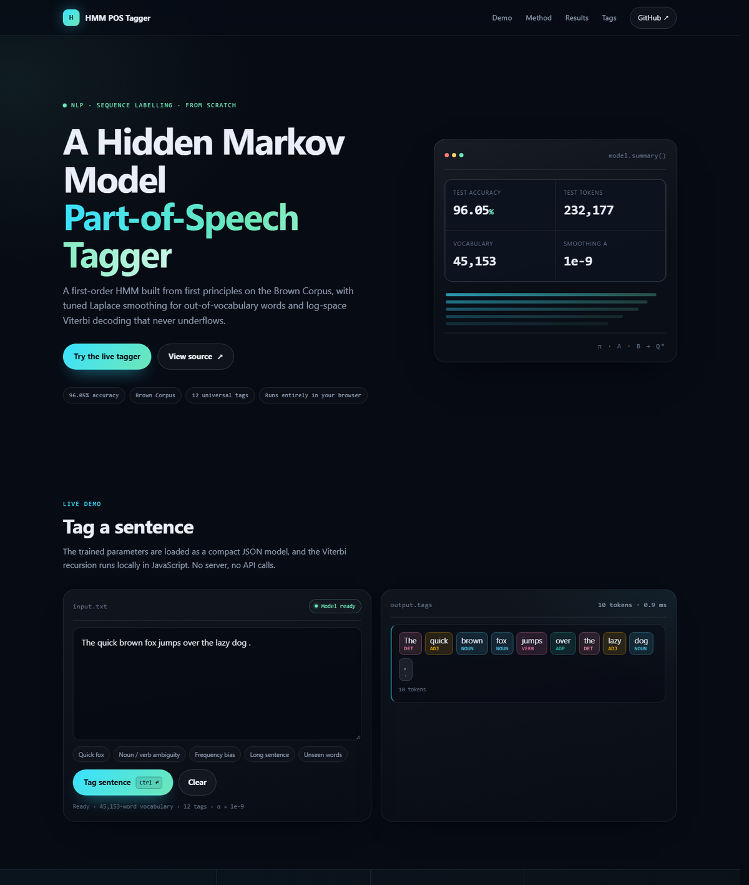

# HMM Part-of-Speech Tagger

**A first-order Hidden Markov Model built from first principles — 96.05% word-level accuracy on the Brown Corpus.**

[](HMM_NLP/README.md#-experimental-results)
[](https://heangdeniss.github.io/HMM-Text_Segmentation/)
[](https://www.python.org/)
[](https://www.nltk.org/)
[](https://en.wikipedia.org/wiki/Brown_Corpus)

**[Try the live tagger →](https://heangdeniss.github.io/HMM-Text_Segmentation/)** · [Notebook](HMM_NLP/Mode.ipynb) · [Paper](HMM_NLP/HMM_NLP.pdf) · [Full documentation](HMM_NLP/README.md)



## Overview

This project implements a complete part-of-speech tagger from scratch — no `hmmlearn`, no `nltk.tag.hmm` — and solves the two problems that break textbook HMMs on real text:

- **Out-of-vocabulary words** never receive zero emission probability, thanks to an explicit `<OOV>` bucket and tuned Laplace smoothing.
- **Long sentences** never underflow, because the Viterbi trellis runs entirely in log-space.

The smoothing parameter α is selected with a validation-only grid search (`1e-12 … 1.0`), which finds a sharp optimum at **α = 1e-9**. The final model is evaluated on an untouched 20% test split of the Brown Corpus with the 12 Universal POS tags.

| Metric | Result |
| :--- | :---: |
| Test accuracy | **96.05%** |
| Correct tokens | 223,015 / 232,177 |
| Error rate | 3.95% |
| Add-one baseline | 93.80% |
| Relative error reduction | 36.3% |
| Vocabulary | 45,153 words |
| Training sentences | 45,872 |

## Saved model

The trained parameters are committed so the tagger works without retraining:

- `models/hmm_pos_model.pkl` — compact Python model (`π`, `A`, emission counts, metadata)
- `docs/model/hmm_pos_model.json` — sparse browser model used by the live demo

Only non-zero emission counts are stored. Any unseen `(word, tag)` pair receives exactly the same probability as `<OOV>`, so the compact artifact is mathematically equivalent to the full 12 × 45,153 table.

```python
import sys
sys.path.insert(0, "HMM_NLP")

from hmm_model import load_model, tag_text

model = load_model("models/hmm_pos_model.pkl")
for pairs in tag_text("It was a very tempting offer .", model):
    print(pairs)
```

Or from the command line:

```bash
cd HMM_NLP
python hmm_model.py tag "The quick brown fox jumps over the lazy dog ."
python hmm_model.py evaluate   # reproduces 96.05%
```

## Website

The site in [`docs/`](docs/) is a fully static GitHub Pages deployment with a client-side implementation of log-space Viterbi. It loads the sparse JSON model once, tags text locally, and renders colour-coded POS chips — no server, no API calls.

To deploy it:

1. Push the repository to GitHub.
2. Go to **Settings → Pages**.
3. Choose **Deploy from a branch → `main` → `/docs`**, then **Save**.

Local preview (why not `file://`? because browsers block local `fetch`):

```bash
python -m http.server 8000 --directory docs
# open http://localhost:8000
```

Regenerate the model and website export:

```bash
cd HMM_NLP
python hmm_model.py build
```

## Repository layout

```
.
├── HMM_NLP/          # Notebook, reusable module, paper, slides, detailed docs
├── models/           # Saved Python model (.pkl)
├── docs/             # Static GitHub Pages website
└── README.md
```

## Authors

Department of Applied Mathematics and Statistics, Institute of Technology of Cambodia.

- **Denis HEANG** — [@heangdeniss](https://github.com/heangdeniss)
- **Udomveasna CHHEANG**
- **Ratana SEING**
- **Lyheng SIENG**

See [HMM_NLP/README.md](HMM_NLP/README.md) for the full methodology, mathematical formulation, α grid-search table, error analysis, and references.
